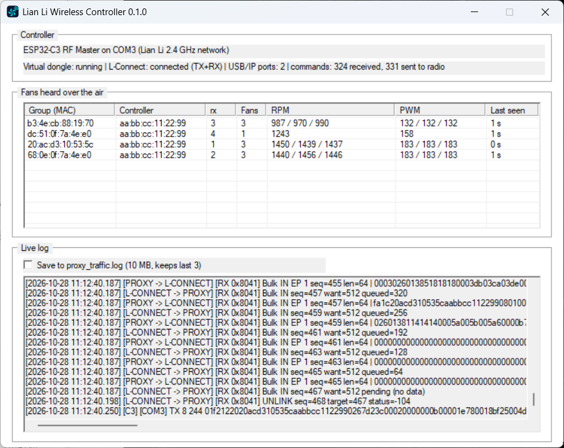

# Lian Li Wireless Controller

Open-source replacement for the Lian Li L-Wireless USB dongle. An ESP32-C3 board becomes the RF
Master, and a Windows app presents it to **L-Connect 3** as the original dongle. Use it to control
**UNI FAN SL / TL Wireless** fans (speed, RGB, bind, identify) without the proprietary dongle.

Not affiliated with or endorsed by Lian Li. "Lian Li", "L-Connect" and "UNI FAN" are trademarks of
their owners.



## How it works

```
L-Connect 3 ⇄ USB/IP (virtual dongle 0416:8040 TX + 0416:8041 RX) ⇄ lianli-controller.exe ⇄ USB serial ⇄ ESP32-C3 ⇄ 2.4 GHz ⇄ fans
```

- `lianli-controller.exe` runs a USB/IP server on `127.0.0.1:3240` and attaches two virtual devices
  that match the original dongle chips (TX `0416:8040`, RX `0416:8041`).
- TX Bulk OUT commands from L-Connect go to the ESP32-C3 over its USB-Serial-JTAG port.
- The ESP32-C3 transmits them on the Lian Li network and reports every fan status packet it hears.
- The app builds the RX status report from those packets, so L-Connect shows real fans, RPM and PWM.

Protocol details: [docs/PROTOCOL.md](docs/PROTOCOL.md). Internals: [docs/ARCHITECTURE.md](docs/ARCHITECTURE.md).

## Requirements

| Item | Notes |
|---|---|
| Windows 10/11 x64 | The app requires administrator rights (UAC prompt). |
| [usbip-win2](https://github.com/vadimgrn/usbip-win2) **≥ 0.9.8.1** | `winget install vadimgrn.usbip-win2`. Older drivers corrupt kernel memory when a pending URB is cancelled (BSOD 0x0A / 0x139). |
| L-Connect 3 | Official Lian Li software. |
| ESP32-C3 board | Any board with the native USB-Serial-JTAG port (e.g. ESP32-C3 SuperMini). |
| Lian Li wireless fans | SL Wireless / TL Wireless family. |

Use exactly one controller. Unplug the original dongle: L-Connect accepts a single controller and
the app refuses to start when it detects more than one.

## Install

1. Download `lianli-controller-<version>-windows-x64.zip` from the [releases page](https://github.com/erycson/lianli-wireless-controller/releases) and extract it.
2. Flash the ESP32-C3 (once):
   ```powershell
   pip install esptool
   esptool --chip esp32c3 --port COM3 write_flash 0x0 lianli-c3-<version>.bin
   ```
   Replace `COM3` with the board's port. If the port does not respond, hold **BOOT**, plug the board
   in, release BOOT, and flash again. Reconnect it **without** holding BOOT afterwards.
   To update the firmware, close `lianli-controller.exe` (it holds the port) and flash the new
   `lianli-c3-<version>.bin` with the same command. The firmware keeps no settings, so nothing is lost.
3. Install usbip-win2 and L-Connect 3.
4. Run `lianli-controller.exe`.

## Use

- **GUI (default):** run the exe. It detaches stale virtual ports, finds the ESP32-C3, starts the
  bridge, attaches the virtual dongle and starts the L-Connect services. The window lists the fans
  heard over the air and a live log. Closing the window keeps it running in the tray.
- **Tray menu:** *Open*, *Start with Windows*, *Exit*.
- **Start with Windows:** creates a logon task with highest privileges that starts the app hidden in
  the tray. When the exe moves, the next launch re-points the task to the new location.
- **Single instance:** a second launch brings the running window to the front and exits.
- **Pairing fans:** in L-Connect, open *L-Wireless Sync Setup*, click the link icon in the *Status*
  column of each fan, then enable *Lock Bound Devices*.

### CLI

```powershell
lianli-controller.exe detect              # find the ESP32-C3, check for other controllers
lianli-controller.exe status              # USB/IP driver, virtual ports, L-Connect services, autostart
lianli-controller.exe bridge start        # run the bridge in the console (--c3 COM3 forces the port)
lianli-controller.exe ports list|attach|detach
lianli-controller.exe autostart on|off
```

Enable **Save to proxy_traffic.log** in the window to record every USB/IP and serial exchange to
`proxy_traffic.log` next to the exe. The file rotates at 10 MB and keeps the last 3 (`.1`..`.3`).
The setting persists in `HKCU\Software\LianLiWirelessController` (`LogToFile`). Off by default.

## Build

```powershell
cargo test --lib
cargo build --release          # target\release\lianli-controller.exe
```

Firmware: see [firmware/esp32c3/README.md](firmware/esp32c3/README.md).

## Layout

```
src/
├── main.rs            CLI entry; GUI by default; single-instance guard
├── gui/window.rs      Win32 window and tray
├── bridge/            USB/IP server emulating the dongle (descriptors, URB loop, RX report)
├── hardware/
│   ├── c3_link.rs     serial link to the ESP32-C3, controller detection
│   ├── autostart.rs   logon task
│   └── service_mgr.rs L-Connect service control
└── traffic_log.rs     proxy_traffic.log + live log buffer
firmware/esp32c3/      ESP-IDF 4.4 firmware (ESPeranto-based radio)
assets/                icon sources
docs/                  protocol and architecture
```

## License

MIT, see [LICENSE](LICENSE). The ESPeranto component in `firmware/esp32c3/components/esperanto`
keeps its own MIT license and attribution.
